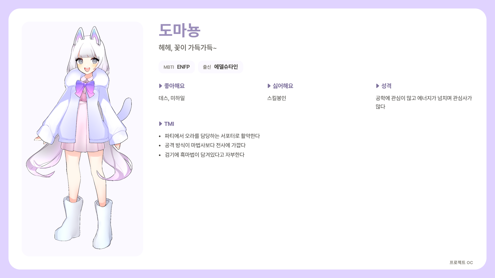

# project-oc

캐릭터 출처: 리슝좍. 원작자에게 허락을 받아 사용됩니다.

캐릭터를 좋아하는 사람을 위해 만든 프로필 제작 사이트입니다.

[웹사이트](https://projectoc.org)

## 사용된 기술
- 런타임: Node.js
- 사용 언어: TypeScript
- 프레임워크: Next.js
- 데이터베이스: MySQL
- ORM: Prisma
- 계정 및 JWT 관리: Auth.js
- 호스팅 업체: Vercel

## AI로 캐릭터 이미지를 만드는 기능을 안 넣은 이유
일부 사용자는 "왜 AI로 캐릭터 이미지를 만드는 기능을 안 넣었을까?"라고 생각하실 수 있습니다. 실제로 제가 교육받았을 때 창업 강사가 이 프로젝트를 보고 "AI로 캐릭터 이미지를 만드는 기능을 넣으면 좋을 거 같다."라는 의견을 주었습니다. 그러나 전 이 사이트에 AI로 캐릭터 이미지를 만드는 기능을 절대로 넣지 않을 겁니다.
일단 AI로 이미지 만들어 주는 사이트는 수도 없이 많습니다. 당장 구글의 Nano Banana, OpenAI의 GPT Image가 있고, 이 모델의 API를 사용해서 제작 기능을 넣는 거보다 사용자가 해당 모델의 웹사이트를 통해 이미지를 생성하고 마음에 안 들면 수정을 요구해서 다시 만드는 게 낫다고 생각했습니다. 이 기능을 만들기에는 시간이 오래 걸리고, 수요가 낮다고 생각해 넣지 않았습니다.
그리고 창작자는 AI 그림을 굉장히 싫어합니다. 특히 서브컬처계의 게임에서 AI가 생성한 캐릭터를 출시하면 반발이 매우 클 정도로 매우 싫어합니다. 저도 일러스트레이터가 되기 위해 그림을 열심히 그린 적도 있어서 창작자분들이 AI 그림을 싫어하는 이유를 잘 알기에 넣지 않았습니다.
대신에 넣은 게 AI를 통해 프로필 초안을 만드는 기능입니다. 사용자가 프로필 설정 또는 캐릭터 이미지를 입력하면 AI가 프로필에 맞게 양식을 자동으로 채워줍니다. 프로필에 반영하기 전에, 설정 오류 등 사용자가 마음에 안 들면 해당 요소만 반영을 안 할 수 있고, 사용자가 입력한 모든 요소는 AI 학습에 절대 사용되지 않습니다.

### 그러나 이 프로젝트에 AI를 아예 안 넣은 건 아닙니다.
우선, 이 프로젝트의 일부 코드는 Anthropic의 Claude가 작성했습니다. 처음에는 Next.js의 감각을 익히기 위해 마크업과 CSS를 AI가 맡고 기능 코드는 제가 맡았습니다. 프로젝트 후반에 Next.js에 익숙해지고, AI, 직장 동료가 작성한 코드를 이해하는 능력을 기르기 위해 일부 기능 코드를 AI에게 맡겼습니다. R2 버킷 이동 같은 중요한 코드는 제가 작성했고, AI가 작성한 코드를 확인해서 AI가 놓친 버그와 UX를 해치는 요소를 수정했습니다.
또한 코멘트 판정은 TypeSafe AI의 Jev를 사용했습니다. 저 혼자서 코멘트 검사를 할 수 없기 때문에 Jev로 검증을 했고, 성적, 고어를 제외한 이용 정책에 위반되면 코멘트 작성/수정을 거부하도록 되어 있습니다. 물론 AI 특성상, 잘못된 판단을 내릴 수 있기 때문에 이용 정책에 위반 판정이 애매할 경우 코멘트를 숨기는 걸로 조치했습니다.

그럼에도 AI로 이미지를 만드는 기능을 넣지 않을 것입니다. 이 리포지토리를 걸고 맹세하니, 걱정하지 마십시오.

## project-oc의 신기한 기능들

### 프로필 공개 여부에 따라 R2 버킷 분리
보안을 중요시한다면 당연히 넣을 기능이고 이 프로젝트가 작음에도 불구하고 넣은 이유는, 정말로 캐릭터 이미지가 외부에 드러나지 않았으면 하는 사용자가 있을 거라고 생각했기 때문에 넣었습니다. 저도 제작한 캐릭터 프로필 일부는 외부에 드러나는 걸 원하지 않기 때문에 저랑 비슷한 사용자가 있을 거라고 충분히 생각합니다. 비공개 버킷에 있는 이미지는 서명된 URL을 활용했고, 페이지에 방문할 때마다 GetObject가 요청돼서 사용 횟수가 쌓이는 걸 막기 위해 `ResponseCacheControl` 필드의 `max-age`를 적용, `signingDate` 필드에 현재 시각에서 5분 단위로 내린 `Date` 객체를 넣어 일정 시간 동안 재방문해도 캐시된 데이터를 불러오게 구현했습니다.

관련 PR: [#83](https://github.com/Unknown123465/project-oc/pull/83)

### AI 킬 스위치 적용
AI를 호출하는 API일 경우, 사용된 양만큼 과금이 나가는 구조라 해킹 또는 사용자가 몰려 호출 횟수가 과도하게 많아져서 과금이 많이 나가는 경우가 존재합니다. 이는 API뿐만 아니라 AWS 같은 IaaS를 사용하는 회사면 충분히 공감할 수 있는 요소라고 생각합니다. 따라서 저는 AI 킬 스위치를 넣어 과금이 많이 나가는 걸 방지했습니다.
킬 스위치는 Vercel Global Config로 구현했고, 런타임에 끌 수 있다는 특징이 있어서 재배포되는 동안 기존에 배포된 걸로 AI 호출을 막을 수 없는 걸 방지할 수 있습니다.
크레딧 한도를 걸어서 막는 방법도 있으나, AI 프로필 초안 생성 한정으로 기능 사용 시 사용자에게 올바른 오류 메시지를 출력할 수 없다는 점이 있어서 크레딧 한도와 함께 킬 스위치를 추가했습니다. 코멘트 등록/수정 같은 경우는 내용 검증을 하지 않고 그대로 작성/수정됩니다.

## 다음과 같은 분이면 project-oc를 강력 추천합니다!
- 만든 캐릭터는 많지만 프로필 카드를 만들기 귀찮은 창작자
- 복잡한 양식이 아닌 간단한 양식으로 프로필을 만들 수 있는 창작자
- 웹사이트로 만든 프로필을 클릭 한 번으로 PNG 파일을 저장하는 걸 원하는 창작자
- 본인이 만든 프로필을 링크로 공유하고 싶은 창작자
- 본인만 볼 수 있는 프로필을 만들고 싶은 창작자
- 캐릭터 설정 또는 이미지 첨부만으로 자동으로 양식이 채워지는 걸 원하는 창작자
- 사이트 측에서 본인이 만든 프로필이 AI 학습에 사용되는 걸 싫어하는 창작자

## 하지만 다음과 같은 분이시면 다른 프로필 사이트를 사용하시는 걸 권장합니다.
- 프로필을 커스터마이징하고 싶은 창작자
- 마이너하거나 복잡한 요소를 프로필에 넣고 싶은 창작자. 이 요소는 TMI로 적을 수 있으나, 요소가 많으면 project-oc를 쓰기 어려울 거 같습니다...
- 독자와 활발한 소통을 원하는 창작자. 코멘트 기능은 있으나, 답글 기능은 없습니다...

제가 추천하는 대안은 [CharacterHub](https://characterhub.com)입니다. 프로필을 커스터마이징할 수 있고, 다양한 요소를 입력할 수 있습니다.

## project-oc를 만들게 된 재밌는 에피소드를 들려드리겠습니다.
project-oc를 만들기 전에는 Windows 10을 개선한 사이트를 만들고 있었습니다. 그러나 Windows 11에서 이미 개선된 요소가 있었고, 제 지인이 이거보다 캐릭터 프로필 사이트를 만드는 게 어떠냐고 제안했습니다. 이 제안은 흥미로웠고, CharacterHub 같은 프로필을 제작하는 사이트를 둘러보았습니다. 매우 흥미로웠고, 감탄사가 나왔습니다.
하지만 이 사이트들에 아쉬운 점이 있었습니다.
첫 번째는 프로필 디자인을 커스터마이징할 수 있어서 통일되어 있지 않았습니다.
두 번째, 프로필에 넣을 요소가 너무 많았습니다. 일부는 마이너 중 마이너한 요소라서 "이게 과연 필요할까?"라는 생각도 들었습니다. 물론 이 많은 요소를 필수로 넣어야 하는 건 아니지만, 신규 사용자가 봤을 때 본인이 넣고 싶은 요소를 어떤 걸 선택해야 하는지 혼란이 올 거 같았습니다.
그럼에도 좋은 요소는 있었습니다. 첫 번째는 프로필 공개 여부를 정할 수 있었습니다. 사용자가 만든 프로필을 링크로만 볼 수 있게 하거나 본인만 볼 수 있는 걸 원할 수 있습니다. 의외일 수도 있지만, 저도 거기에 포함되었습니다. 두 번째는 퍼스널 컬러였습니다. 캐릭터 창작자는 "아! 이런 느낌의 캐릭터!"라는 걸 독자에게 알리고 싶을 겁니다. 인식하기 위해선 캐릭터의 이미지가 가장 중요하다고 생각하지만, 퍼스널 컬러가 2번째로 중요하다고 생각했습니다.
지인의 제안, 기존 프로필 제작 사이트의 아쉬운 점을 개선하고, 제가 원하는 기능을 바탕으로 사이트를 만들었습니다. 네, 이게 바로 project-oc입니다. 창작의 세계에 오신 것을 환영합니다!

## 로컬 실행과 테스트 방법
[이 파일을 확인해 주세요.](project-oc/README.md)

## 라이선스
이 리포지토리는 AGPL-3.0-only 라이선스로 배포됩니다.